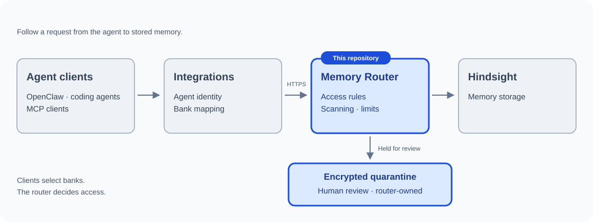

# Architecture

[Documentation](../README.md) | [Repository](../../README.md)

Canonical model: [`workspace.dsl`](workspace.dsl)  
Interactive architecture: [Structurizr site](https://mickey-kras.github.io/hindsight-memory-router/)

`workspace.dsl` defines C1 to C3, dynamic, and deployment views as architecture code.
Structurizr validates and renders the model.
It does not infer architecture from Python.
Update the DSL in the same PR as runtime changes that affect architecture.
Files under `generated/` come from the DSL or README overview generator.
Do not edit generated files manually.

Dynamic views cover principal authorization, client coordination, routing, policy, security and review workflows. The health and version endpoints stay in the structural and API references. The model stops at C3.

## README overview

Each README uses the same topology and highlights its own repository.
Each has separate SVG assets for the light and dark themes.
Generate this repository's pair with `python3 scripts/architecture-overview.py`.
`make architecture` also runs that command.
Export the integrations pair directly into that repository:

```sh
python3 scripts/architecture-overview.py --repository integrations --output-dir ../hindsight-memory-router-integrations/docs/architecture
```

Each repository commits only its own pair there. The diagrams deliberately omit deployment details. README `<picture>` elements select the theme and give a light fallback.

## Overview and detailed views

<a href="https://mickey-kras.github.io/hindsight-memory-router/">
  <picture>
    <source media="(prefers-color-scheme: dark)" srcset="generated/overview-dark.svg">
    <source media="(prefers-color-scheme: light)" srcset="generated/overview-light.svg">
    
  </picture>
</a>

- [C1: System Context](https://mickey-kras.github.io/hindsight-memory-router/#SystemContext): users and external systems.
- [C2: Containers](https://mickey-kras.github.io/hindsight-memory-router/#Containers): runtime processes and data stores.
- [C3: Components](https://mickey-kras.github.io/hindsight-memory-router/#Components): responsibilities inside the API.

## Dynamic views

- [Principal authorization](https://mickey-kras.github.io/hindsight-memory-router/#PrincipalAuthorization): authenticate credentials and check bank and scope grants before memory access.
- [Integration reads](https://mickey-kras.github.io/hindsight-memory-router/#IntegrationReads): client fan-out, shared budget, partial results, and authorization failure handling.
- [Retain queue / replay](https://mickey-kras.github.io/hindsight-memory-router/#RetainReplay): transient outage queuing and current write-bank checks.
- [Retain](https://mickey-kras.github.io/hindsight-memory-router/#Retain): the write path.
- [Recall](https://mickey-kras.github.io/hindsight-memory-router/#Recall): the read path.
- [Compatibility operations](https://mickey-kras.github.io/hindsight-memory-router/#CompatibilityOperations): the shared flow for the bank, config, mental-model and reflect operations that the integrations use.
- [Quarantine / review](https://mickey-kras.github.io/hindsight-memory-router/#QuarantineReview): browser or CLI decryption and decision outcomes.
- [Quarantine recovery](https://mickey-kras.github.io/hindsight-memory-router/#QuarantineRecovery): reconciliation after an operator examines ambiguous side effects.
- [Startup / shutdown](https://mickey-kras.github.io/hindsight-memory-router/#StartupShutdown)

### Limits of the implementation

Principal-mode requests authorize the explicit bank and operation scope. In the legacy writer mode, the router maps writer IDs to banks. Its server-side recall fan-out is separate from the client-side coordination of more than one bank. The client mapping never grants server access.

Integration retain queues hold **plaintext transcripts on the agent host**. They are separate from the router's encrypted quarantine. OpenClaw and the MCP adapter use the shared coordinator when you configure it. Coding-agent adapters also have harness-specific capture and cursor behavior.

Review approval of a kept request examines its original destination and current grant again. Then it writes to Hindsight.
Approval of a recalled memory permits that reviewed memory without another retain.
Rejection invalidates the recalled memory.
If a reviewer rejects a kept request, the router does not write it.
Postpone defers review.

After an ambiguous side effect, an operator examines Hindsight and reconciles the current snapshot.
The router does not replay the operation without verification.
See [review operations](../operations/quarantine-review.md).

The browser console decrypts RSA-OAEP envelopes with WebCrypto. Provider-wrapped envelopes must have review tooling configured for the same provider. See [quarantine review](../operations/quarantine-review.md).

These flows come from `memory_router/principal_gate.py`, `request_dispatch.py`, `policy.py`, and `admin.py`. The client flows follow the integrations repository's `src/shared/recall-coordinator.ts`, `retain-coordinator.ts`, and `src/mcp/server.ts`.

## Deployment

- [Single node with SQLite](https://mickey-kras.github.io/hindsight-memory-router/#SingleNode)
- [Cluster with PostgreSQL](https://mickey-kras.github.io/hindsight-memory-router/#Clustered)

## View names

The interactive site uses explicit human-facing prefixes:

- `C1:`, `C2:`, `C3:` for the formal C4 hierarchy.
- `Dynamic:` for runtime interaction views.
- `Deployment:` for deployment views.

If the link names no view, the static site opens on System Context.
It adds a persistent view selector.
The built-in quick navigation of Structurizr is available with `Space`.

## Updating

```bash
make architecture
```

Docker is necessary. `make architecture-site` builds the uncommitted static site used by GitHub Pages.


